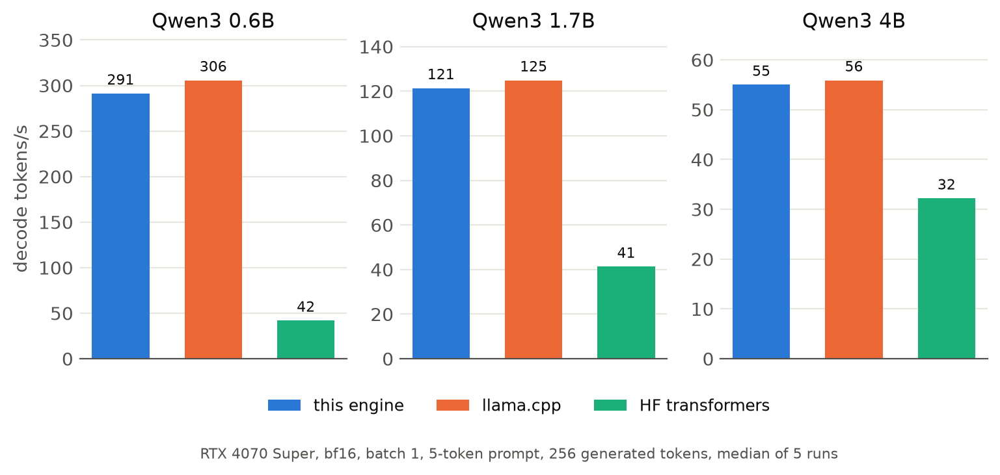
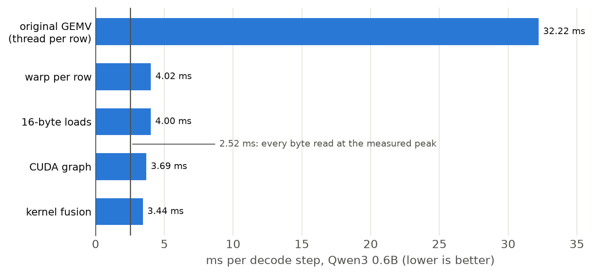
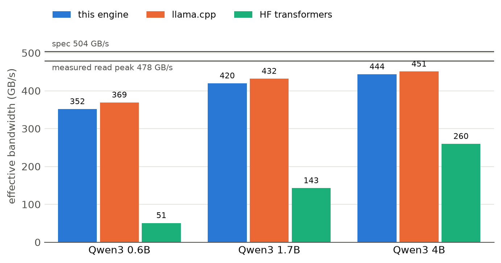
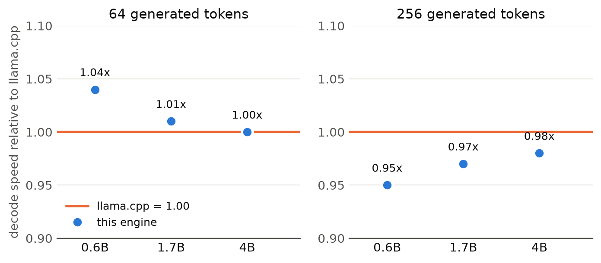

# llm-inference

An LLM inference engine written from scratch in C and CUDA. It runs Qwen3 (0.6B, 1.7B and 4B) in bf16 on a single GPU. I wrote every kernel by hand: GEMV, RMSNorm, RoPE, attention with a KV cache, SwiGLU, greedy and temperature sampling. And every layer was checked against Hugging Face transformers.

On an RTX 4070 Super it decodes at 291 tokens/s on Qwen3-0.6B and 55 tokens/s on Qwen3-4B at batch size 1, which is 92.6% of the measured memory bandwidth (478.5 GB/s) and is within 2 to 5% of llama.cpp.

<picture>
  <source media="(prefers-color-scheme: dark)" srcset="docs/throughput-dark.png">
  
</picture>


## Results

RTX 4070 Super (Ada, 504 GB/s spec), CUDA 13.4, driver 615.78, CachyOS. bf16 weights, batch size 1, greedy decoding, 5 token prompt then 256 generated tokens, median of 5 runs.

| | Qwen3-0.6B | Qwen3-1.7B | Qwen3-4B |
| --- | ---: | ---: | ---: |
| decode tokens/s | 291.2 | 121.4 | 55.0 |
| ms per token | 3.43 | 8.24 | 18.20 |
| % of measured read bandwidth (478.5 GB/s) | 73.5% | 87.7% | 92.6% |
| % of spec bandwidth (504 GB/s) | 69.8% | 83.2% | 87.9% |
| llama.cpp tokens/s (256 tokens) | 305.7 (0.95x) | 124.9 (0.97x) | 55.9 (0.98x) |
| llama.cpp tokens/s (64 tokens) | 309.3 (1.04x) | 125.6 (1.01x) | 56.1 (1.00x) |
| HF transformers tokens/s | 41.9 | 41.3 | 32.2 |


## Why I Built This

I'm super interested in ML and low level stuff. I wanted to learn and explore how exactly an LLM works and how they are optimized, and the best way to do so was to actually write its inference, all the way down to the GPU kernels themselves. 


## How a Decode Step Works

At batch size 1, generating one token means reading every weight in the model once (1.2 GB on 0.6B, 8 GB on 4B) to do a small amount of math with it. So the decode is mostly memory-bound. That's why everything here is measured as "% of bandwidth", its the bytes read per token divided by time per token compared with what the GPU can read.

Each step is 228 kernels. All of them except the sampling kernel are captured once in a CUDA graph and replayed every token. One decoder layer is 8 of them:

```
x (hidden state, bf16)
|
+-- rmsnorm                                 RMSNorm
+-- qkv_kernel          q, k, v = W x       one launch for all three projections
+-- qk_norm_rope        QK-norm + RoPE      also writes k, v into the KV cache
+-- attention           softmax(q K^T) V    over every cached position, GQA (2 or 4 q heads per kv head)
+-- gemv_residual       x = x + Wo attn     output projection with the residual add fused in
+-- rmsnorm                                  RMSNorm
+-- gate_up_kernel      h = silu(Wg x) * (Wu x)   both projections and SwiGLU in one pass
+-- gemv_residual       x = x + Wd h        down projection + residual
|
x -> next layer (28 layers on 0.6B and 1.7B, 36 on 4B)
```

Apart from the layers there is an embedding lookup at the start, and at the end a final RMSNorm, the LM head GEMV and an argmax, or temperature sampling on the GPU.

Thre's nothing harcoded so the same code can run all three model sizes. Every shape comes from the model's `config.json`, and the loader checks every tensor in the safetensors files against the shape the config gives before anything runs.


## The Optimization Process

Every step below was measured on Qwen3-0.6B. Every element was a different optimization step I added.

<picture>
  <source media="(prefers-color-scheme: dark)" srcset="docs/history-dark.png">
  
</picture>

| step | ms/token | what changed |
| --- | ---: | --- |
| original GEMV (`e1ea710`) | 32.22 | One thread per output row. It's slow because adjacent threads read addresses a row apart so there's almost no coalescing (16.5 memory sectors per request instead of 2), and the small matrices only launched 4 to 12 blocks for 56 SMs. |
| warp per row (`23a495f`) | 4.02 | 32 threads share a row and read consecutive addresses then reduce with a warp shuffles. 8x performance in one change. |
| 16-byte loads (`94f1811`) | 4.00 | `uint4` loads of 8 bf16 at a time.|
| CUDA graph (`9bee197`) | 3.69 | The whole step is captured once and replayed with a single launch which removes the CPU overhead between the roughly 500 kernels.|
| kernel fusion (`a5ef78e`) | 3.44 | Went from 508 kernels per step to 228: q/k/v in one launch, gate/up/SwiGLU in one, residual adds folded into the GEMVs, QK-norm + RoPE + KV in one. |

The line on the chart is the theoretical floor: 2.52 ms if every byte were read at the measured peak.

**Where the time goes now** (nsys, GPU time per token):

| | Qwen3-0.6B | Qwen3-1.7B | Qwen3-4B |
| --- | ---: | ---: | ---: |
| GEMVs (all projections + LM head) | 2,641 us (85%) | 7,360 us (93%) | 17,033 us (96%) |
| GEMV read bandwidth | 451 GB/s | 468 GB/s | 472 GB/s |
| attention | 253 us | 255 us | 325 us |
| everything else (norms, RoPE, argmax) | 230 us | 322 us | 463 us |

The GEMVs read at 94 to 99% of the read peak, so the main kernel is basically at the limit of the hardware. What's left for the small models is the fixed cost of attention and the small kernels, which don't shrink with the model. That's also why the % of bandwidth goes up with model size.


## Design Decisions

**Why only the decode path?**

The prompt is fed through the decode path one token at a time (like llama2.c), so getting correct end-to-end generation only needed GEMV-style kernels and no matrix-matrix multiply. That kept v1 small enough to finish and verify. The cost is that the engine makes no claim about time-to-first-token. A real prefill path (tiled GEMM, causal attention) is the next big piece.

**Why copy Hugging Face's bf16 rounding points?**

Activations are stored in bf16 like HF and every kernel accumulates in fp32, rounding to bf16 at the same places HF does (after each projection, inside RMSNorm, SwiGLU and attention). That way the only difference from the reference is summation order, so the correctness check can be tight and a real bug stands out immediately.

**Why one warp per output row in the GEMV?**

A GEMV reads each weight exactly once, so the only thing that matters is reading memory efficiently. With a warp per row, the 32 threads read 32 consecutive 16-byte chunks of the same row, which the hardware combines into full 512-byte transactions. It's simple, and on the big matrices it already reads at 98% of the measured peak.

**How are fused kernels still checked layer by layer?**

Fusing kernels hides the intermediate tensors the correctness harness compares (like `q` before RoPE). The fused kernels take optional "tap" pointers that are NULL normally and set only when dumping, so every tensor the harness checks still comes out of the fused code itself.

**Why no CPU reference implementation?**

Hugging Face transformers is the reference. A Python script runs the same prompts through it and dumps every intermediate tensor, and the engine dumps it's own in the same format. Comparing the two in forward order points at the exact op that's wrong, which is a lot more useful than "the logits are off".


## Correctness

- `make check-weights`: every tensor on the GPU matches the safetensors file bit for bit.
- `make check`: 6 prompts, every intermediate tensor of every layer (479 to 615 per prompt) compared against HF by the worst relative error, then greedy generation compared token by token.
- Greedy output matches HF exactly (except for ties when HF's top two logits are equal or very close and both choices are correct).
 - A few single rows on 1.7B and on 0.6B go over the testing tolerance. Each were looked at and are confirmed to just be rouding imprecision.
- `compute-sanitizer` memcheck clean on all three sizes, racecheck clean on 0.6B.


## Benchmarks

How the numbers are measured:
- `make record-quiet` is a custom script that would turn my displays off and check that the GPU was idle first for consistency.
- Median of 5 runs after a warmup run, wall clock between `cudaDeviceSynchronize` calls.
- Bytes per token are counted exactly from the model shapes (all weights, the tied embedding table once, the average KV cache read).
- The "measured read bandwidth" is a read-only kernel in `bench/bandwidth.cu` (16-byte loads over a 512 MiB buffer, fastest of 12 launch shapes): 478.5 GB/s, 95% of the spec. A device-to-device copy only reaches 431 GB/s because it also writes, which doesn't make it correct the correct number to use for comparing decode.

<picture>
  <source media="(prefers-color-scheme: dark)" srcset="docs/bandwidth-dark.png">
  
</picture>

**llama.cpp** is the main comparison. Same GPU, BF16 GGUF converted from the same checkpoint (not quantized), all layers on the GPU, flash attention on, CUDA graphs on, the same 5-token context and the same number of generated tokens.

<picture>
  <source media="(prefers-color-scheme: dark)" srcset="docs/vs-llamacpp-dark.png">
  
</picture>

**Important to note:** the engine is similar to llama.cpp or ahead on short generations, but 2 to 5% behind over 256 tokens. My GEMVs are faster (about 2.64 ms vs 2.90 ms per token on 0.6B), but my attention kernel uses one block per head and loops over the cached positions serially, so it does get slower as the context grows (0.25 ms per token at 64 tokens, 0.57 ms at 256). llama.cpp splits the sequence across blocks and merges the partial results (flash-decoding), so its attention stays around 0.16 ms. That's a real improvement over mine and is probably the next thing I will implement. Also, llama-bench never samples while my engine does an argmax every step, so the comparison slightly favour llama.cpp.

**Hugging Face transformers** (eager, bf16, sdpa attention, KV cache) is 1.7x to 6.9x slower, but it's not a fair comparison at batch 1 since it's limited by Python and kernel launch overhead on the CPU, which is why it takes about 24 ms per token on both 0.6B and 1.7B even though 1.7B has 3x the bytes.


## Building and Running

Requirements: Linux, an NVIDIA GPU, CUDA toolkit 13 and uv. The Makefile builds for `sm_89` (Ada); change `-arch` for other GPUs.

```bash
uv sync
uv run hf download Qwen/Qwen3-0.6B --local-dir models/Qwen3-0.6B
make

# text in, streamed text out (the tokenizer is in Python, everything else is the engine)
uv run scripts/generate.py "The capital of France is"
uv run scripts/generate.py "Explain what a GPU is in one sentence." --chat --model models/Qwen3-4B
```

Testing and benchmarking (`MODEL=models/Qwen3-1.7B` etc for other sizes):

```bash
make ref             # dump Hugging Face reference activations for the prompt set
make check-weights   # GPU weights vs the safetensors files
make check           # layerb by layer comparison, then greedy output vs HF
make bench           # tokens/s, % of bandwidth, HF baseline and llama.cpp
make record-quiet    # same, displays off, appended to bench/results.csv
make profile         # per-kernel time per token with nsys
make plots           # the charts in this README from bench/results.csv
```

The llama.cpp baseline runs if `llama-bench` is built in `~/projects/llama.cpp` (override with `LLAMACPP=`) and the model has been converted to `models/<model>-BF16.gguf` there.


## Limitations and What's Next

- There's no prefill: the prompt goes through the decode path one token at a time. Will soon be implemented.
- Batch size 1, one GPU, a contiguous KV cache capped at 4,096 positions.
- The tokenizer is the Hugging Face one in Python. The engine takes and returns the token ID.

Next steps are a flash-decoding attention kernel (to fix the long-context gap with llama.cpp), then a real prefill path with tiled tensor-core GEMM and causal attention, then a paged KV cache and batching.


## Credits

- [cJSON](https://github.com/DaveGamble/cJSON) (MIT, vendored in `third_party/cjson`) parses `config.json` and the safetensors headers.
- Andrej Karpathy's [llama2.c](https://github.com/karpathy/llama2.c) and [llm.c](https://github.com/karpathy/llm.c) were very useful for the approach.
- [Hugging Face transformers](https://github.com/huggingface/transformers) is the reference for correctness, and [llama.cpp](https://github.com/ggml-org/llama.cpp) is the reference for performance.
- [Qwen3](https://huggingface.co/Qwen) models by the Qwen team.
- Claude: My goal was to learn, so I wrote every kernel by hand as well as the decode loop etc (everything I considered important). However I used AI help for stuff like checking HF tensor weights, obtaining the HF intermediate tensors to verifiy correctness, benchmarking llama.cpp, plotting the results etc as I did not have much experience with that.

## License

MIT
